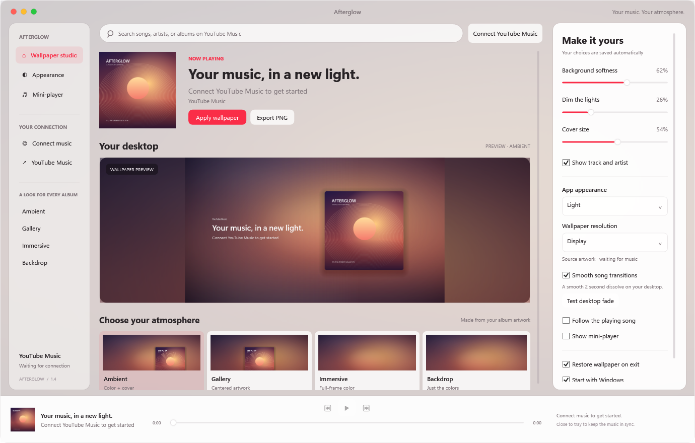

# Afterglow

Your current YouTube Music album cover, turned into a Windows wallpaper.

I wanted my desktop to match whatever I was listening to, with the soft colors and big album art you get in a fullscreen music player. Afterglow follows the song playing on the YouTube Music website and builds a wallpaper around its cover.

## What it does

- Album art over a soft background made from the cover's colors.
- Four layouts, plus controls for blur, dimming, cover size and track text.
- GPU crossfades when the song changes, including on multiple monitors.
- Display-sized, 1080p or 4K wallpapers and lossless PNG exports.
- Optional play/pause, previous, next and seek controls, plus a floating mini-player.
- Saved settings, light and dark themes, tray support and an option to restore your previous wallpaper.

It's free and open source under the MIT license.

## Try it

You'll need Windows 10 or 11 on an x64 PC, and Chrome or Edge.

1. Download `Afterglow-Windows-x64.zip` from this repository's Releases section.
2. Extract it to a folder you plan to keep, then run `Afterglow.exe`. The .NET runtime is included.
3. Open `chrome://extensions` or `edge://extensions`, enable Developer mode, choose **Load unpacked**, and select the included `extension` folder.
4. In Afterglow, open **Connect music** and copy the pairing key. Paste it into the extension's options and choose **Save & test connection**.
5. Reload your YouTube Music tab, play a song, then choose a style and enable **Follow the playing song**.

The extension is currently installed manually. Keep both Afterglow and the music tab running; closing the studio leaves it in the tray.

## A note on how it was built

This was mostly vibe-coded with Codex, then iterated on using actual Windows desktop tests. The first fades were pretty choppy, so the current version uses Windows GPU composition instead of rebuilding a whole wallpaper every frame.

It's a hobby project, and there are probably rough edges I haven't hit yet. If you try it, I'd love to know whether setup makes sense and how the fades look on your monitor setup. Bug reports and small fixes are welcome.

## How the connection works

The extension reads the current song and artwork from your YouTube Music tab and talks to Afterglow through an authenticated server on `127.0.0.1:47836`. Playback controls go back to the paired tab. It uses your existing browser session and doesn't handle Google passwords or cookies.

Artwork comes from the YouTube/Google image hosts. The app asks for a larger cover when one is available, but a small original still has limited detail. Wallpaper text and layout render at the selected resolution.

Preferences stay in local app data. Wallpaper images and restoration backups are in **Pictures > Afterglow**. There are no analytics, subscriptions or cloud accounts for Afterglow.

## A few limits

This works with the YouTube Music website, not a phone app or a separate desktop player. Music videos can supply video thumbnails instead of album covers. Desktop fades need a Direct3D 11 hardware device and Windows interface animations; if that isn't available, the finished wallpaper applies directly. Explorer's desktop behavior can change after Windows updates.

Afterglow applies one wallpaper using Fill across your displays. It doesn't yet offer separate album layouts for each monitor. Artwork rights belong to their respective owners. This project isn't affiliated with Google, YouTube or Apple.

## Build or contribute

See [BUILD.md](BUILD.md) for the .NET 8 and C++ build requirements. The app source is in `src/Afterglow`, the graphics helper is in `src/Afterglow/Native`, and the browser extension is in `extension`.

[Verification notes](VERIFICATION.md) describe what was checked and the limits of those checks. [Research notes](RESEARCH.md) cover the apps and Windows APIs that informed the design.
